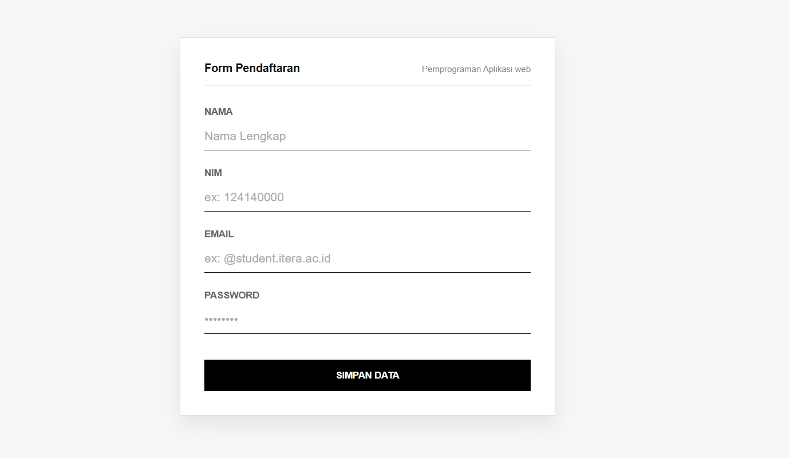
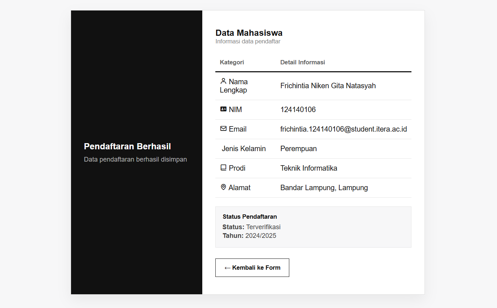

# TASK 3

* **Nama:** Frichintia Niken Gita Natasyah
* **NIM:** 124140106
* **Link Repository GitHub:** https://github.com/yoursky12/pemweb.git

---

## Tampilan Halaman Web (Screenshot)

### 1. Halaman Form Pendaftaran (`index.html`)

### 2. Halaman Detail Informasi Pendaftar (`informasi.html`)

---

## A. Penjelasan Kode `index.html`

1. **Struktur Utama & Header**
   * `
` berfungsi sebagai wadah (*container*) utama tampilan pendaftaran
   * `<h2 id="form-title">` dan `` menampilkan judul utama halaman serta keterangan

2. **Formulir Pendaftaran (`<form>`)**
   * `<form action="informasi.html" method="GET">` membuat formulir untuk mengirimkan data ke halaman `informasi.html`
   * `method="GET"` menetapkan metode pengiriman data melalui URL

3. **Input Nama Lengkap & NIM**
   * `<label>` memberikan keterangan untuk setiap kolom input
   * Input `nama` dan `nim` menggunakan `type="text"` untuk menerima masukan berupa teks atau angka
   * Atribut `required` memastikan kolom wajib diisi sebelum formulir dapat dikirimkan
   * Atribut `placeholder` menampilkan contoh teks petunjuk pengisian

4. **Input Email & Password**
   * `type="email"` digunakan untuk memasukkan alamat email dan memungkinkan browser memeriksa format email
   * `type="password"` digunakan untuk menyembunyikan karakter yang diketik oleh user demi keamanan

5. **Tombol Submit**
   * `<button type="submit" id="btn-submit">` membuat tombol pendaftaran yang berfungsi untuk mengirimkan seluruh data formulir ke halaman

---

## B. Penjelasan Kode `informasi.html`

1. **Layout Container & Kolom**
   * `
` membagi halaman menjadi dua bagian, yaitu `.FormLeft` dan `.FormRight`

2. **Tabel Detail Mahasiswa (`<table>`)**
   * `<table>` dengan kelas `.InfoTable` digunakan untuk menampilkan data pendaftar
   * `<th>` membuat judul kolom (*Kategori* dan *Detail Informasi*).
   * `<td>` menampilkan data biasa yang berisi ikon `Boxicons` beserta rincian informasi
3. **Status Pendaftaran & Tombol Kembali**
   * `
` menampilkan kotak keterangan status verifikasi pendaftaran
   * `<a href="index.html" class="back-button">` membuat tautan berbentuk tombol yang mengarahkan pengguna kembali ke halaman utama `index.html`.

---

## C. Penjelasan Kode `style.css`

1. **Element Selector**
   * `body`: Mengatur jenis huruf (*font*), warna latar belakang, serta memosisikan konten agar tepat berada di tengah layar (*flexbox*).
   * `label`: Mengatur tampilan teks label kolom input agar cetak tebal dan berwarna abu-abu.
   * `table`, `th`, `td`: Mengatur lebar tabel 100%, menghilangkan jarak antar sel (*border-collapse*)

2. **Class Selector**
   * `.card`: Mengatur wadah form pada `index.html` dengan latar putih, batas tipis, dan efek bayangan (*box-shadow*).
   * `.FormContainer`: Mengatur tata letak kotak 2 kolom pada `informasi.html`.
   * `.FormLeft` & `.FormRight`: Mengatur panel kiri berwarna hitam dan panel kanan berisi tabel informasi.
   * `.form-group`: Memberikan jarak antar kolom input pada formulir.
   * `.back-button`: Mengubah tampilan tautan kembali menjadi tombol dengan garis pembatas tegas.

3. **ID Selector**
   * `#form-title`: Mengatur ukuran, ketebalan, dan warna judul utama formulir.
   * `#btn-submit`: Mengatur desain tombol *submit* berwarna hitam penuh dengan efek perubahan tingkat transparansi (*opacity*) saat kursor diarahkan ke atasnya (*hover*).
